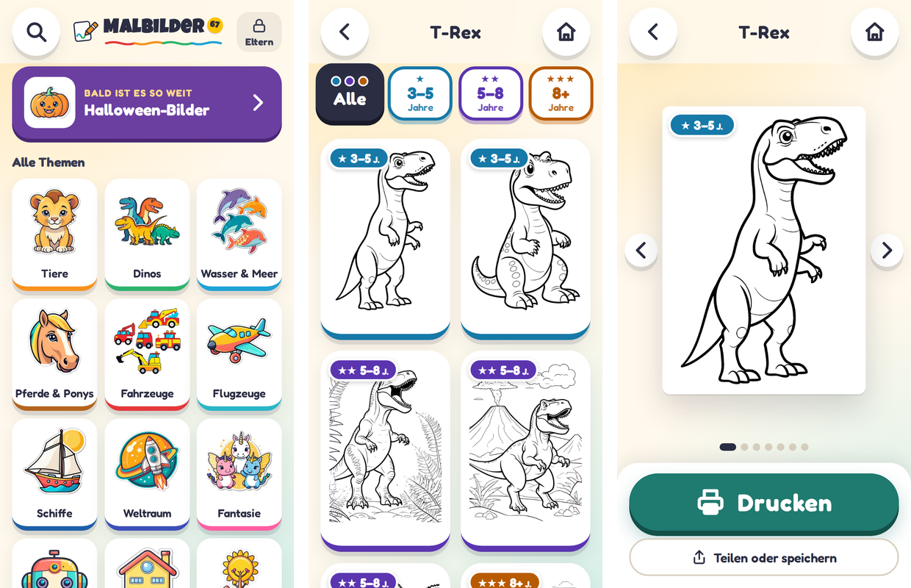

# 🖍️ Malbilder67

**Kostenlose Ausmalbilder für Kinder – aussuchen, antippen, drucken.**
Ohne Werbung, ohne Anmeldung, ohne Datensammeln.

👉 **[s84n.github.io/malbilder67](https://s84n.github.io/malbilder67/)**

## Worum geht's?

Mal schnell ein Ausmalbild drucken, und das Kind wünscht sich einen Dino, ein Einhorn oder einen Bagger?
Statt sich durch Seiten voller Werbung und Pop-ups zu klicken, sucht sich das Kind das Bild hier selbst aus.
Es braucht dafür nicht lesen zu können: große, bunte Bilder führen zum Ziel, ein großer Knopf druckt.

- **Über 1.200 Malbilder** zu 17 Themen
- **Für jedes Alter** – die Motive gibt es einfach (3–5 Jahre), mittel (5–8) und detailliert (8+)
- **Druckt sauber auf A4** in Schwarzweiß, eine Seite pro Bild
- **Funktioniert auf Tablet, Smartphone und PC** – am besten im Browser öffnen und
  „Zum Startbildschirm hinzufügen“, dann wirkt es wie eine App; schon angesehene Bilder gehen auch offline
- **Kostenlos und werbefrei**, kein Konto, keine Cookies, keine Tracker

## Themen

| | |
|---|---|
| 🦁 **Tiere** | Dinos, Bauernhof, Waldtiere, Haustiere, Safari & Zoo, Käfer & Schmetterlinge, Vögel, Kuschel-Stars |
| 🐠 **Unterwasserwelt** | Delfin, Wal, Oktopus, Schildkröte, Hai, Seepferdchen … |
| 🐴 **Pferde & Ponys** | Pferd, Pony, Fohlen, Reiten |
| 🚗 **Fahrzeuge** | Autos, Baustelle, Feuerwehr & Polizei, Züge, Flugzeuge & Schiffe |
| 🚀 **Weltraum** | Rakete, Astronaut, Planeten, Ufo … |
| 🦄 **Fantasie** | Feen, Einhörner, Drachen, Meerjungfrauen, Prinzessinnen & Ritter |
| 🤖 **Roboter** | vom Roboterhund bis zum Riesenroboter |
| 🏰 **Häuser & Städte** | Burgen, Häuser, Stadt |
| 🌻 **Natur** | Landschaften, Blumen & Pflanzen |
| 👨‍👩‍👧 **Menschen** | Familie, Berufe, Spielen & Sport |
| 🍦 **Essen** | Obst, Pizza, Eis, Süßigkeiten |
| 🎂 **Feste** | Weihnachten, Ostern, Halloween, Geburtstag, Fasching, Schulanfang, Muttertag |
| 🏴‍☠️ **Abenteuer** | Piraten, Superhelden, Wilder Westen, Ninja |
| ⚽ **Sport** | Wintersport, Wassersport, Ballsport, Turnen & Tanzen |
| 🎸 **Musik** | Instrumente, Musizieren |
| 🍂 **Jahreszeiten** | Frühling, Sommer, Herbst, Winter |
| 🌀 **Mandalas & Muster** | Mandalas, Tier-Mandalas |

## Für Eltern

Oben rechts auf der Startseite gibt es den Knopf **„Eltern“** – geschützt durch eine kleine Rechenaufgabe
oder eine eigene PIN. Dort lässt sich einstellen:

- **Themen ein- und ausblenden** – ganze Kategorien oder einzelne Bereiche, z. B. nur Halloween
- **Altersstufen ausblenden** – z. B. die detaillierten Bilder für ein Kindergartenkind
- **Tageslimit fürs Drucken** – damit nicht der ganze Papierstapel auf einmal draufgeht
- Verlauf löschen, alles zurücksetzen

**Drucken:** Der Knopf öffnet den normalen Druckdialog des Geräts (AirPrint auf iPhone/iPad, Druckdienst auf Android).
Beim ersten Mal den WLAN-Drucker, A4 und „Schwarzweiß“ wählen – das Gerät merkt sich das.

## Datenschutz

Die App kennt keine Konten, zeigt keine Werbung und bindet keine fremden Dienste, Schriften oder Statistik-Tools ein.
Verlauf, Einstellungen und der Druckzähler bleiben nur auf dem jeweiligen Gerät und werden nirgendwohin gesendet.
Die Seite liegt auf GitHub Pages; GitHub erhält dabei – wie bei jeder Website – technisch die IP-Adresse beim Abruf.

## Über die Bilder

Alle Malbilder wurden mit einer KI erzeugt (Stable Diffusion XL) und einzeln von Hand geprüft, bevor sie
aufgenommen wurden. Sie sind für die private, nicht-kommerzielle Nutzung gedacht; es werden keine Rechte
an den Bildern beansprucht. Sollte trotzdem einmal ein misslungenes Bild dabei sein, freue ich mich über
einen Hinweis als [Issue](https://github.com/s84n/malbilder67/issues).
